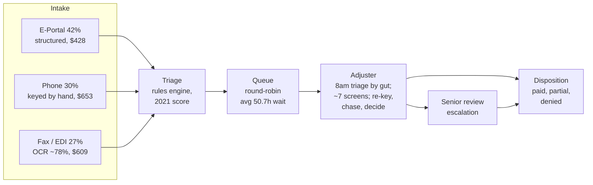
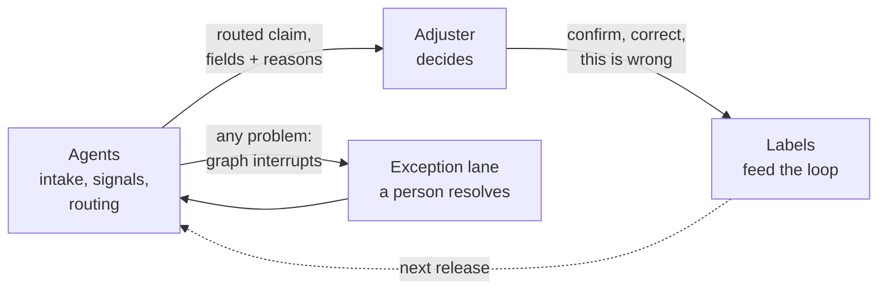
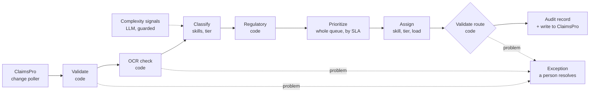
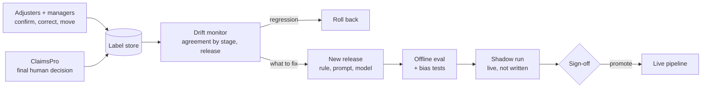

# Slides draft: reimagining claims handling with agentic AI

Draft content for transfer to Keynote. Each slide has a headline (the claim the slide makes), body content, and speaker notes with sources. The audience has no background on the scenario, so the deck sets it up before any point of view. Numbers come from the 5,000-claim extract and are reproducible with `python3 analysis/review_floor.py`.

The deck follows a standard case-study brief: the problem, why this problem, what's at stake, the agentic solution, the UX, and what building a prototype taught me.

**Order and timing (45 min talk, then Q&A):**

| # | Slide | Brief section | Time |
|---|---|---|---|
| 1 | The scenario | Background | 2 min |
| 2 | The constraints | Background | 2 min |
| 3 | How a claim moves today | The problem | 3 min |
| 4 | Three claims, shadowed | The problem | 3 min |
| 5 | Where the time and the errors go | The problem | 2 min |
| 6 | Why this problem | Why this problem | 2 min |
| 7 | What we can realistically move | What's at stake | 3 min |
| 8 | The point of view | Solution | 2 min |
| 9 | Five ways to work with a legacy system | Solution: the box | 2 min |
| 10 | What we're not building yet | Solution: decisions | 2 min |
| 11 | The agents, and what stays human | Agentic solution | 3 min |
| 12 | Handoffs, and when the agent is wrong or unsure | Agentic solution | 3 min |
| 13 | What the adjuster sees | UX | 2 min |
| — | Demo | UX | 8 min |
| 14 | Who this changes, and how we'll know | UX and outcomes | 2 min |
| 15 | Where the first pass goes | Plan | 1 min |
| 16 | What building taught me | Bonus | 2 min |
| 17 | How I got here | Process | 1 min |
| A1 | Architecture | Reserve | 2 min |
| A2 | The feedback loop | Reserve | 2 min |

Slides A1 and A2 are a reserve: present them if time allows, or hold them for Q&A.

---

## Section 1: Background

## Slide 1: The scenario

**Headline:** A claims administrator wants its first production AI capability, after two attempts that didn't work.

**Body:**

- **The client:** Tyrell Corporation's Insurance Services unit, a third-party administrator. It handles ~400K commercial auto claims a year for insurance carriers, with 95 adjusters.
- **The engagement:** Acme, an AI partner, has six months and $5M. Two weeks of discovery decide what gets built; a checkpoint at month 3 decides whether it continues.
- **Where we are:** the end of week 1. Three discovery calls are done: a kickoff, an operations walkthrough on the floor, and a systems session. The client has handed over a 5,000-claim extract, an analytics memo and three sample claim files.
- **The ask:** one recommendation for what to build first, the reasoning, and a working demo.

**The cast:** Daniel Ashford (GM, the sponsor), Rachel Whitmore (VP Claims Operations), Owen Hale (VP Engineering, whose team ran both earlier attempts).

**Speaker notes:**

- Everything is fictional: the companies, the people, the claims. The constraints are modeled on real ones in US insurance.
- Sources: `docs/project/sow.md`; `AGENTS.md`.

---

## Slide 2: The constraints

**Headline:** The model is the easy part. The constraints decide the design.

**Body:**

- **AI cannot decide a claim.** Every denial is a human decision. Twelve states require human review of any decision over $10K. Eight more restrict automated adjudication without the policyholder's consent, and nobody tracks that consent.
- **Everything is audited.** Every AI-assisted decision needs a five-field record (input, model version, output, confidence, human-reviewed flag), kept seven years, with a readable rationale on demand.
- **The system of record is a legacy vendor platform.** ClaimsPro has REST for reads, SOAP for writes, a webhook that is late and drops ~5% of events, and, deliberately, no API for claim decisions.
- **Two earlier attempts failed.** A 2021 automation score shipped with no feedback loop, drifted, and lost the adjusters' trust. A recent RAG project never converged.
- **Engineering capacity is borrowed.** The client's platform team reviews and advises; it doesn't build.

**Speaker notes:**

- Owen's bar for production: "if the team cannot show him how they know it's right, and keep showing him, it does not go near live claims." That sentence shapes the whole solution.
- Sources: `memory/calltranscripts/w1-thu-owen-systems.md`.

---

## Section 2: The problem

## Slide 3: How a claim moves today

**Headline:** Three-quarters of a claim's life is spent waiting for someone to pick it up.

**Body:**

| Step | Who | Input | Output | Where it breaks |
|---|---|---|---|---|
| Intake | Portal, call-center agent, OCR/EDI parser | Claim forms, calls, faxes, EDI files | A claim record in ClaimsPro | OCR errors land unchecked; the EDI parser silently drops ~1 in 8 submissions |
| Triage | ClaimsPro rules engine | The claim record | A queue, a review flag, a 2021 score | The flag over-fires; the score is ignored ("it's usually wrong") |
| Assignment | Round-robin | The queue | A claim on an adjuster's list | Blind to age, deadline and skill |
| Handling | Adjuster | ~7 ClaimsPro screens, documents, notes | A decision, or an escalation | Re-keying and chasing before any judgment |
| Senior review | 12 seniors, 4 leads | Escalated claims | A decision | Days of records-gathering on complex files |

**Speaker notes:**

- Average cycle: 66.8h, of which 50.7h is queue wait and 16.1h handling. Handling is time open, not effort: at 15–18 claims a day, an adjuster spends roughly 30 minutes of real work per claim.
- Rachel's own read: "half my cycle-time problem is a dispatch problem" (Ops, 20:15).
- Sources: `reference/analytics_memo.md`; `memory/calltranscripts/w1-tue-rachel-ops-walkthrough.md` (summary); `reference/data_dictionary.md:93`.

---

## Slide 4: Three claims, shadowed

**Headline:** The clean claim waits. The fax claim gets re-typed. The hard claim gets rebuilt by hand.

**Body:**

| Claim | What happened | What it shows |
|---|---|---|
| **IS-CLM-2025000300**: Florida collision, e-portal, $2,825 | Complete at intake, paid in full. 34.7h cycle, almost all of it waiting in a queue | Even the best case misses a 24h target, and nobody touched it for most of that time |
| **IS-CLM-2025002993**: California, fax, ~$49K | OCR read an estimate line as "1,B00" instead of 1,800; the fax cut off the claimant's contact, so a phone chase followed. After all the cleanup, a pre-existing-damage denial | "I spend more time fixing what the fax machine ate than deciding anything." (senior adjuster, 11 years) |
| **IS-CLM-2025004222**: New York bodily injury, phone, $59.5K | 208 hours, 117 of them waiting. The second-year adjuster built the injury timeline by hand from a rough auto-transcript, was unsure on coverage, escalated, and waited four days in senior review | The judgment call has no precedent to lean on; it's in people's heads |

**Speaker notes:**

- Morning ritual on the floor: open ClaimsPro, read the overnight queue, triage by gut. Nothing is sorted by age, risk or SLA.
- The senior adjuster's warning: fixing intake "fixes the mornings". Her week goes to the complex files, a fifth of the queue and most of her hours.
- Sources: `sample_claims/`; `memory/calltranscripts/w1-tue-rachel-ops-walkthrough.md` (56:10–62:15 for 4222).

---

## Slide 5: Where the time and the errors go

**Headline:** Time is lost before the adjuster starts. Errors enter at intake and are never caught.

**Body:**

| | Finding | Source |
|---|---|---|
| **Time** | 76% of the cycle is queue wait. Simple claims wait 41.7h on average; only 34% finish under 24h | Extract |
| **Time** | Fax and phone claims cost ~1.5× portal claims, mostly in re-keying and chasing | Analytics memo |
| **Errors** | ~110K fax/EDI claims a year pass through ~78%-accurate OCR with no human check | Systems session |
| **Errors** | ~12% of EDI partner submissions are dropped silently | Systems session |
| **Errors** | The review flag agrees with reviewers on 76% of a 500-claim sample: 99 needless reviews, 21 needed ones missed | Script, section 4 |
| **Compliance** | 85 of 5,000 claims meet the stated $10K rule but carry no review flag: ~6,800 a year | Script, section 9 |
| **People** | 15–18 claims a day, 22% annual turnover, volume up ~8% a year. Exit interviews: "too much time on paperwork, not enough on judgment" | Ops walkthrough |

**Speaker notes:**

- The regulatory finding is the one to raise privately with Owen first: it's a gap in his system, and the fix is one routing condition.
- Sources: `analysis/review_floor.py` sections 4 and 9; `reference/analytics_memo.md`; `docs/discovery/open_questions.md` ("Already answered from the data").

---

## Section 3: Why this problem

## Slide 6: Why this problem

**Headline:** It's the hard version of the problem, and the hard parts are exactly where an AI-native product beats a SaaS one.

**Body:**

**Why I picked it:**

- It's regulated, legacy-bound, and has already failed twice. If an approach works here, it works in easier places.
- The obvious pitch (an AI that adjudicates claims) is off the table by law. That forces the more interesting question: what does AI do when it can't decide?

**Why AI-native, not traditional SaaS:**

| Traditional SaaS | AI-native |
|---|---|
| Works on structured fields | Reads the unstructured evidence where the work actually is: faxes, transcripts, notes, photos |
| Replaces the system, or adds a screen | Works beside a system it can't replace, and writes back into it |
| Ships features; quality is fixed at release | Improves from every correction, and shows the improvement |
| Rules are opaque to the people they affect | Every output carries its source and reason, which is what an auditor and a skeptical adjuster both need |

**Speaker notes:**

- The 2021 score is the counter-example: a model with no loop, no explanation and no source, which adjusters learned to ignore.
- Under-served today: the adjuster's mornings (re-keying), the queue (round-robin), and the second-year's judgment calls (no precedent).

---

## Section 4: What's at stake

## Slide 7: What we can realistically move

**Headline:** Faster to the right person, fewer errors in the record, less rework per claim, and an audit trail that holds up.

**Body:**

| Outcome | Today | Target | How |
|---|---|---|---|
| **Cycle time** | Simple claims: median 34.7h, 34% under 24h | Median simple claim under 24h | Order queues by deadline, match by skill and tier. Capping wait at 12h puts ~96% of simple claims under 24h |
| **Errors entering the record** | OCR and EDI output lands unchecked | No unchecked OCR field enters ClaimsPro; no silent EDI drop | Cross-check sources at intake; surface every gap to a person |
| **Adjuster time per claim** | Re-keying and chasing before any judgment | Re-keyed fields near zero on confirmed extractions; one-click confirmation for complete, simple claims | Pre-processed intake; a fast lane a person still confirms |
| **Cost to serve** | ~$545 a claim, ~$218M a year | Toward −25% blended | Less wait and rework now; moving fax senders to the portal adds up to ~9% |
| **Routing quality** | 76% agreement with reviewers | ~90% | Rebuild the review flag on the 500 calibration labels, then live corrections |
| **Regulatory gaps** | ~6,800 claims a year meet the rule without a review flag | Zero | Route on either flag: one condition, before any AI |
| **Customer satisfaction** | 3.2 (paid in full 3.65, denied 2.24) | Up on every disposition | Faster outcomes, and an explanation with every decision |
| **Auditability** | No decision-level logging | Every AI-assisted step logged with the five fields, kept seven years; agreement reported by release | Built into the pipeline, not added later |

**What the world looks like if it works:** an adjuster opens ClaimsPro to a queue that's already sorted, claims that are already clean, and a short note on each saying why it's theirs and what needs their judgment. Rachel can see why any claim is waiting. Owen can show an auditor how any routing call was made.

**Speaker notes:**

- Every 1% of cost to serve is ~$2.2M a year. Channel shift alone doesn't reach −25% (≤8.8% from fax, ~21% if phone moves too), so the rest has to come from lighter human work per claim.
- CSAT moves on decisions and communication more than speed: claims under 24h average 3.24, over 72h 3.14.
- Targets are hypotheses with real baselines; each gets a measurement plan in the scope document, as the SOW provides.
- Sources: `analysis/review_floor.py`; `reference/analytics_memo.md`; `docs/discovery/open_questions.md`; `demo/data/history.json` (agreement target).

---

## Section 5: The agentic solution

## Slide 8: The best change is one the adjuster barely notices

**Headline:** The car runs better; the dashboard doesn't change.

**Body:**

- **Who:** 95 adjusters on ClaimsPro, seven or eight screens deep. The primary user is the second-year adjuster, the one who handled claim 4222.
- **The point of view:** fix what happens *before* the adjuster opens a claim: intake, validation, prioritization, routing to the right person. Show the result in ClaimsPro's own fields. Add new interface only where the existing one hits a wall.
- **The human stays in the loop:** the adjuster makes every decision. The agents prepare, order, explain and record; they never approve or deny.
- **The ideal, set aside:** an adjuster opens ClaimsPro and sees one thing, the next right claim for them. ClaimsPro can't be made to work that way, but every step moves toward it.

**Speaker notes:**

- "Don't build us an eighth screen" (Ops, 86:20).
- Sources: `memory/calltranscripts/w1-tue-rachel-ops-walkthrough.md`.

---

## Slide 9: Five ways to work with a legacy system; two fit here

**Headline:** We build beside ClaimsPro, not inside or instead of it. This is the box every design has to live in.

**Body:**

| # | Approach | Verdict | Why |
|---|---|---|---|
| 1 | Replace the UI; ClaimsPro as a headless backend | ✗ | Claim decisions can only be entered in the ClaimsPro UI or by batch file, by design |
| 2 | Build inside ClaimsPro with a vendor SDK or plugin | ✗ | No SDK exists |
| 3 | Replace ClaimsPro | ✗ | A system-of-record migration doesn't fit 6 months and $5M |
| 4 | **Write into ClaimsPro's own fields** (notes, custom fields) | ✓ | Custom fields exist; SOAP writes cover notes and documents. Durable, auditable, survives if anything else breaks |
| 5 | **Overlay beside ClaimsPro** (managed browser extension) | ✓ | SaaS in a browser; IT can force-install. Reads the open claim, shows our panel, calls our backend |

**Visual:** five columns, three greyed out; 4 and 5 joined by a bracket labeled "together".

**Speaker notes:**

- This is strategy, not plumbing: it rules out every design that depends on replacing or re-skinning ClaimsPro.
- 4 and 5 work together, in that order: custom fields come first, as the record and the adjuster's v1 view. The overlay comes only when the fields hit a wall. If the extension is ever down, the fields still show in ClaimsPro.
- Also rejected: bots driving the ClaimsPro screens. They break on every vendor release and would route around the deliberate decisioning gap.
- Sources: Systems, 4:40 and 5:45; clarification call (SaaS, no SDK, custom fields, force-installable extensions).

---

## Slide 10: What we're not building yet, and when it would come back

**Headline:** No new interface for adjusters until the existing one hits a wall.

**The assumption everything rests on:** ClaimsPro's custom fields are prominent on the screens adjusters already use, and make sense there. If that's wrong, the same content moves into the side panel for display, and stays stored as custom fields in ClaimsPro.

**Body:**

| Rejected for now | Why | Where it could come back |
|---|---|---|
| **A separate app in another tab** | Adds another screen; splits attention | Managers only: the pipeline monitor is its own page |
| **Rebuilding the eight-screen experience** | No decision API, SOAP-only writes; not doable in six months | A side-panel summary and table of contents: **the first side-panel version** |
| **A chat agent** | An interface looking for a problem | Later, in the same side panel, if it earns a place |
| **Auto-approval** | Consent is untracked in 8 states; claims over $10K need review in 12 | A one-click, human-confirmed fast lane instead |
| **Precedent search** | Built from old notes, it copies past judgment forward, bias included | Later, with bias testing: the second-year adjuster's top ask |

**Speaker notes:**

- Name the tension before the sponsor does: "We spent $5M and nobody sees anything different." The answer: the change is visible where it's measured, in the pipeline monitor. The side panel is the tangible thing on the adjuster's screen, once routing has earned trust.

---

## Slide 11: The agents, and what stays human

**Headline:** Five agents, and only one of them needs a model.

**Body:**

| Agent | Job | How it works | Can it decide a claim? |
|---|---|---|---|
| **Intake** | Validate the claim, cross-check OCR against EDI and other sources, list what's missing | Code; proposes OCR corrections that code checks word by word | No |
| **Signals** | Read notes, transcripts and OCR for what fields don't capture: injury, causation gaps, disputes, low-confidence passages | **LLM**, guarded: masked input, strict schema, every signal quotes its source | No; it can only raise a claim's tier |
| **Routing** | Classify skills and tier, check regulatory status, order by deadline, assign by skill, tier and load, validate the route | Code: hard rules are never delegated to a model | No |
| **Writer** | Write custom fields to ClaimsPro, verify the write, retry, alert | Code, with idempotent retries | No |
| **Monitor** | Track agreement with reviewers by stage and release; flag drift | Code; proposes fixes, never applies them | No |

**What stays human, and why:**

- **Every claim decision:** approve, deny, pay. The law requires it, and it's where the judgment is.
- **Coverage, fault and causation calls:** the agents lay out the evidence; the adjuster weighs it.
- **Anything an agent flags as a problem:** it goes to a person, never to a default.
- **Releases:** a change to a rule, prompt or model is signed off by people before it goes live.
- **Teaching the system:** corrections come from people.

**Speaker notes:**

- Calling deterministic steps "agents" is deliberate: each has one job, its own inputs and outputs, and can scale or fail on its own. The model is used only where rules can't read.
- In the demo, the side panel's summaries are written per claim. In production, a briefing agent would write them under the same guard as Signals.
- Sources: `demo/backend/pipeline/graph.py`; `demo/backend/pipeline/llm_signals.py`; `demo/backend/pipeline/intake.py`.

---

## Slide 12: Handoffs, and when the agent is wrong or unsure

**Headline:** Agents can only send a claim toward more human attention, never less.

**Body:**

**Three handoffs:**

1. **Agent to adjuster:** a routed claim arrives with its reason, review lane and what's missing, in ClaimsPro's own fields. The adjuster decides.
2. **Agent to person, on a problem:** any agent that finds one stops the claim. It waits in the exception lane until a person resolves it: nothing is dropped, nothing is guessed.
3. **Adjuster to agent:** confirm, correct (with the right value), or "this is wrong". Each becomes a labeled example.

**When the agent is wrong or unsure:**

| Situation | What happens |
|---|---|
| Sources disagree (OCR vs EDI) | Both shown side by side; the adjuster picks |
| Low-confidence extraction | Marked, with the source passage shown |
| The model's quote isn't in the source | The signal is shown as unverified and ignored for routing |
| The model is down, slow or off-schema | A recorded response loads, marked as a fallback; routing doesn't wait |
| A ClaimsPro write fails | Retried, then alerted; the claim never shows as routed |
| A regulated claim is routed wrong | The route validator blocks it |
| The pattern is wrong, not one claim | Fix the rule once; every similar claim is caught in bulk |

**Speaker notes:**

- The asymmetry is the safety argument: the model can raise a tier, never lower it; the regulatory check is code; the fast lane still needs a person's click.
- Sources: `demo/backend/pipeline/graph.py` (exception node, `interrupt`); `demo/backend/claimspro_sim/reliable.py`; `demo/README.md` ("What contains the output").

---

## Slide 13: What the adjuster sees

**Headline:** Confidence comes from sources, not from scores.

**Body:**

- **In ClaimsPro (v1):** custom fields on the claim: skills, tier, routing reason, review lane, brief status. No new screen.
- **In the side panel (v2), the same six sections on every claim:**
  1. **Header:** skills, tier, time left on the 24h SLA (amber under 6h, red when breached), regulatory status, one-line routing reason.
  2. **What matters:** two to four points, each linked to its source.
  3. **Key facts:** chosen per claim type; collapsed when nothing is unusual.
  4. **Needs attention:** missing items, conflicts, low-confidence spans, each with its sources side by side and a one-click confirm or correct.
  5. **Contents:** where each fact lives; clicking moves the ClaimsPro tab there.
  6. **Footer:** who touched the claim, pipeline version, "this is wrong".

**How it earns trust:**

- Every point links to where it came from; anything that can't be matched is marked unverified.
- It never recommends approve or deny. It shows evidence for a person to judge.
- It shows less when there's less to say: a clean claim gets a short panel.
- Doubt is visible: fallbacks, unverified signals and OCR corrections are labeled, not hidden.

**Visual:** three panels side by side: 0300 (short, fast lane), 2993 (OCR conflict, raw text next to the correction), 4222 (injury timeline with low-confidence transcript spans).

**Speaker notes:**

- Escalations surface in two places: the claim's own header for the adjuster, and the exception lane in the pipeline monitor for managers.
- Sources: `docs/presentation/panel_examples.md`; `demo/backend/templates/panel/`.

---

## Demo (8 min)

Run with `just dev`, then open <http://localhost:8000>. See `demo/README.md` for the extension and the live LLM step.

1. **Pipeline monitor** (`/admin`): the replay plays the extract through the real pipeline; claims move through each stage, and exceptions wait for a person.
2. **Mock ClaimsPro with custom fields** (`/claimspro/IS-CLM-2025004222`): the v1 adjuster view; the pipeline's writes land in ClaimsPro's own fields.
3. **Side panel** on the same claim: why it's here, what's missing, every point linked to its source. Regenerate the complexity signals live.
4. **Claim 2993:** the OCR conflict, and the negation guard.
5. **Audit drawer:** the five-field record, the write history with retries, and the review intervals.
6. **Feedback loop** (`/admin/learning`): agreement and response time by release, with one rollback.

**Unhappy paths to have ready:** the LLM is down (recorded fallback, marked); a quote isn't found (signal ignored for routing); the extension isn't loaded (custom fields still show); a ClaimsPro write fails (retried, then alerted; never shown as routed); the adjuster disagrees (the correction is logged and feeds the loop).

---

## Slide 14: Who this changes, and how we'll know

**Headline:** Five groups, three flows that change, and a measure for each.

**Stakeholders:**

| Who | What they need | What changes for them |
|---|---|---|
| **Adjusters** (95; the second-year is the primary user) | Claims that arrive ready to decide; no eighth screen | Queue arrives ordered; custom fields say why a claim is theirs and what's prepared or missing; corrections take one click |
| **Senior adjusters and leads** (16) | Time back for complex files | Hard claims arrive already routed to them; fewer escalations |
| **Claims operations** | Cycle time down without burning people out | A dispatcher they can tune; visibility into why claims sit |
| **Engineering and Compliance** | "Show me how you know it's right, and keep showing me" | Every route explained and logged; drift visible |
| **The sponsor** | Cost down, demonstrated not promised | A measured path on each target |

**Flows:**

| Flow | Change | Measure |
|---|---|---|
| **Routing:** claim arrives → queue → adjuster | Round-robin becomes ordered and matched by skill and tier | Simple-claim median cycle time; regulated claims without a review step |
| **Preparation:** claim opened → ready to decide | Pre-processing results in custom fields (v1); the side panel (v2) | Human minutes per claim; fields re-keyed; extraction accuracy on an audited sample |
| **Correction:** adjuster disagrees → system learns | The feedback loop | Correction rate trending down; no silent rule changes |

**Speaker notes:**

- Change management: pilot with one team and the adjusters who shaped it; nothing takes a decision away from them; the old score comes off the screen only once the new routing has earned trust.
- Every measure needs a baseline agreed before launch, or month 3 becomes an argument about numbers.

---

## Slide 15: Where the first pass goes

**Headline:** Get the right claim to the right adjuster, ready to decide.

**Body:** three layers, each feeding the next:

1. **Pre-processing and routing (deep):** validate intake and catch what's missing; check regulatory status; order queues by deadline; send hard claims to the right adjuster first.
2. **Custom fields (the adjuster's view, v1):** why the claim was routed, its review lane, what's been prepared or is missing.
3. **Pipeline monitor (managers and Acme):** claims moving through each stage; exceptions that need a person before an adjuster sees them.

**Next, if earned:** the side panel. **Out of scope for now:** auto-approval, precedent search, chat.

**Speaker notes:**

- Why routing first: it's operations' own first fix, and it moves cycle time, the target most clearly within reach.

---

## Slide 16: What building taught me

**Headline:** Five things I wouldn't have known from the desk.

**Body:**

1. **Cleaning OCR can flip the evidence.** On claim 2993, the estimator's note reads `n0t c0nsistent with a fresh impact`. A model tidying "noise" can drop the `n0t` and reverse the basis for the denial. Corrections may now change characters only, and code checks them word by word, with negations highlighted.
2. **Masking has to handle garbled identifiers.** A name the OCR mangled slips past a simple mask. A second pass now refuses to send anything if a known identifier survived.
3. **"No signals" can look like "all clear".** When the guard rejected every signal the model offered, the run still reported full confidence, the same as a clean claim. Now a run with signals offered and none verified reports zero confidence, so it reads as a doubt to check, not an absence of concerns.
4. **A confirmation nobody can see doesn't count.** The fast-lane confirm first lived only in our log. It now writes "intake complete" back to the ClaimsPro record, where the rest of the floor works.
5. **Charts for operators aren't charts for engineers.** Dual-axis learning charts read fine to me and confused lay viewers. Each measure now has its own plot.

**Speaker notes:**

- The common thread: the risky part is never the model call; it's what happens to the output after it.
- Sources: `docs/presentation/panel_examples.md` (claim 3); `demo/backend/pipeline/intake.py` (negation guard); `demo/README.md` ("What contains the output"); git history.

---

## Slide 17: How I got here

**Headline:** From the transcripts to a decision, in five steps, checking each one.

**Body:**

1. **Read the record:** SOW, three discovery calls, the analytics memo, the three sample claims.
2. **Wrote down every question,** with who could answer it and why it mattered (`docs/discovery/open_questions.md`).
3. **Tested the claims in the data,** in a script anyone can re-run, instead of trusting the memo or myself (`analysis/review_floor.py`).
4. **Took positions, then revised them:** auto-approval became a one-click fast lane; skill routing moved earlier.
5. **Picked one adjuster and one claim** and built it end to end, rather than sketching everything.

**Tools:** AI agents for reading, analysis and building, with every number sourced to a file and checked by a script. Everything shown here is mine to defend.

**Speaker notes:**

- The iterations matter more than the steps. Have the before and after of each revised position ready.
- Sources: git history of this repo; `docs/discovery/open_questions.md`.

---

## Reserve

## Slide A1: Architecture: a pipeline where AI is one guarded step

**Headline:** Most of the pipeline is plain code. The LLM does one job, and code checks its work.

**Body:**

- **Why LangGraph:** routing is several steps with branches (any node can hand a claim to a person), so it's a graph, not a prompt. Each node is one stage, emits an event, and can move behind its own queue in production without changing its logic. LangGraph runs trace into MLflow, the client's existing model registry.
- **How the model is contained:** identifiers masked, with a second pass that refuses to send; a strict schema with no approve, deny or recommendation field; every signal quotes its source, and code checks it; a recorded fallback on timeout or failed validation.
- **The human boundary:** when any node finds a problem, the graph interrupts and the claim waits for a person.

**Speaker notes:**

- Scale: at ~1,100 claims a day, throughput isn't the constraint. The long poles are LLM latency and ClaimsPro's SOAP writes, so those stages get their own rate-limited queues first.
- Sources: `demo/backend/pipeline/graph.py`; `docs/architecture/README.md`.

---

## Slide A2: The feedback loop

**Headline:** Every confirmation and correction becomes a label, so the system gets more right and shows it.

**Body:**

- **Labels nobody has to click for:** the poller sees reassignments, escalations and the final human decision in ClaimsPro. Side-panel clicks and queue moves add the rest.
- **Releases, never live edits:** rules, prompts and models change only by versioned release, through offline eval, a shadow run on live claims, and sign-off. Rollback is the same switch back.
- **It closes the audit record:** each record starts with `human_reviewed=False`; the human decision is appended when the poller sees it.

**Speaker notes:**

- This is the direct answer to the 2021 score, which shipped with no loop and drifted unseen.
- The demo's learning-loop charts use illustrative history, including one rollback. The mechanics are real; the data is mocked.
- Sources: `docs/architecture/README.md` ("Feedback loop"); `demo/data/history.json`.
